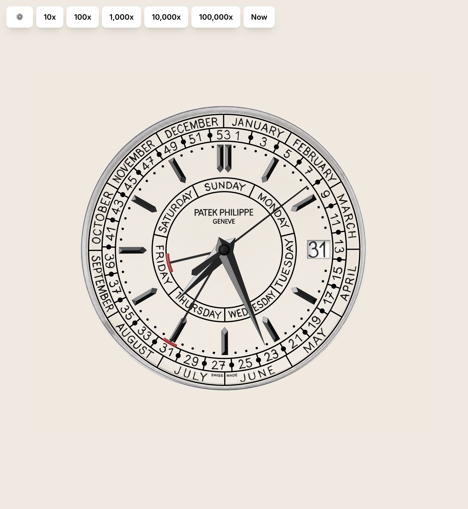

# 5212 — Patek Philippe Weekly Calendar Dial

A pixel-calibrated digital reconstruction of the **Patek Philippe Calatrava Weekly Calendar Ref. 5212A-001**. One measured dial drives a web simulator, a macOS screensaver, and a Garmin watch face.

## Contents

- [Overview](#overview)
- [Quick start](#quick-start)
- [Web simulator](#web-simulator)
  - [Controls](#controls)
  - [3D view](#3d-view)
- [macOS screensaver](#macos-screensaver)
- [Garmin watch face](#garmin-watch-face)
- [Dial calibration](#dial-calibration)
- [Repository layout](#repository-layout)
- [Documentation](#documentation)

## Overview

<p align="center">
  
  
</p>
<p align="center"><sub>Left: the web simulator. Right: the watch face in Garmin's simulator on a fēnix 9 Pro 47 mm.</sub></p>

The dial is drawn programmatically (React + SVG) on top of a 2911 × 2683 orthographic photograph of the real watch. Every radius, sector line, glyph center, and hand silhouette was measured against that photograph and locked in [docs/PROCESS.md](docs/PROCESS.md). The same geometry feeds three outputs:

| Output            | What it is                                                                                                           | Guide                                      |
| ----------------- | -------------------------------------------------------------------------------------------------------------------- | ------------------------------------------ |
| Web simulator     | The calibrated dial over the reference photo, with live time, perpetual calendar, a 3D model, and alignment controls | [Web simulator](#web-simulator)            |
| macOS screensaver | An offline, button-free build of the dial in a native `.saver` bundle                                                | [docs/SCREENSAVER.md](docs/SCREENSAVER.md) |
| Garmin watch face | The dial and hands on a fēnix 6 Pro or fēnix 9 Pro                                                                   | [garmin/README.md](garmin/README.md)       |

What is reproduced:

- Concentric day, week, month, minute, and dial-edge geometry; month, week, and weekday sector divisions; week separator dots and minute markers.
- Four-facet applied hour batons, including the double marker at 12 and the omitted marker at the 3 o'clock date window.
- Week numerals, month names, and weekday names in **Indie Flower**, with measured per-glyph centers and manual optical corrections.
- Five hands in their physical stacking order: day-of-week, week-of-year, hour, minute, seconds.
- Mechanical seconds motion at eight steps per second, matching the 4 Hz (28,800 vph) caliber 26-330 S C J SE.
- Perpetual calendar: ISO week, weekday, and date stay synchronized with local time, including variable month lengths and leap years.
- A 1–31 date wheel isolated from a movement photograph and composited under a transparent aperture with its original bevel shadow. Dates that do not exist in the current month are skipped.

## Quick start

```bash
npm ci
npm run dev
```

The dev server listens on `0.0.0.0:8080`; open <http://localhost:8080>.

Checks:

```bash
npm test          # Vitest: calendar and lighting suites
npm run typecheck
npm run lint
```

The lighting suite guards aperture-shadow continuity at the zenith, zero-brightness behavior, hour-hand facet planarity, and back-face specular masking.

## Web simulator

Two persistent buttons sit on the page: `⚙️` shows or hides the **Controls** window, and `3D` switches to the [3D view](#3d-view). The default view is Photo 100%, Reference 2, Drawing on, Text off, Guides off, Hands on, 3D markers, controls hidden.

### Controls

The **Controls** window drags by its header, including past the screen edges, and has three tabs.

**Time**

- `10x` – `100,000x` accelerate the simulated timeline from the local time captured when the page opened. Pressing the active multiplier again returns to real time.
- `Now` resets the simulated instant and every manual hand or date override to the current local time, keeping the selected speed.
- `Pause` / `Continue` freeze and resume the timeline. Speed changes and pause/continue keep the current simulated instant instead of snapping back to the computer clock.
- The hand selector shows any hand's current angle; `Live` returns a manually positioned hand to its live clock or calendar angle.
- `Week +1`, `Day +1`, and `Date +1` advance their displays by one step. Manual date and weekday positions return to live sync at the next simulated local date boundary; a manual week position returns at the next ISO-week boundary.
- The eight-step seconds beat runs through 10x. Above that the seconds hand rotates continuously, so fast playback has no artificial pauses.

**Layers**

- `Photo` cycles 100% → 50% → off.
- `Reference` switches between the complete watch photo and the aligned dial-only reference.
- `Drawing` toggles rails, sectors, markers, batons, and center geometry. `Text` toggles the generated week, month, and weekday glyphs. `Guides` shows the glyph-center calibration overlay.
- `Hands` toggles the whole hand stack, with individual `Week`, `Day`, `Hour`, `Minute`, and `Second` toggles beneath it.
- `Markers: Flat / 3D` switches the hour markers between the flat calibration artwork and physically lit prisms, and the hour and minute hands between flat artwork and raised two-facet prisms.

The date ring renders at a calibrated radius and center offset that are fixed constants in the component.

**Light**

- Positions a broad light source on a hemisphere and sets its brightness.
- In 3D marker mode, every marker and hand updates its polished black-metal reflection independently; the flat seconds hand gets a restrained deep-black PVD response.
- Adjusts the date-window shading.

### 3D view

- A rotatable three.js model of the watch (`src/components/Watch3D.tsx`). Trackball controls tumble it freely with no pole lock, including around to the dark case back; scroll zooms and right-drag pans.
- Opens straight-on with 12 o'clock up; `Reset view` returns to that framing.
- `⚙️` opens the 3D settings: visibility toggles for the markers, the date wheel, and each hand, plus key-light direction, elevation, intensity, and ambient sliders.
- Built from the same calibrated geometry (`WATCH_GEOMETRY`, exported by `WeeklyCalendarWatch`): the dial is a disc textured with the dial-only reference, the date aperture is a real cutout with walls and a recessed rotating wheel, the hour markers are the measured four-facet prisms, and the hands use their measured silhouettes and ridge heights in physical stacking order.
- The dial is shown caseless, closed by a slim dark rim and back. Hands run on live local time with the same seconds beat and calendar synchronization as the 2D view.

## macOS screensaver

An offline, button-free build of the dial in a native `.saver` bundle. It uses the Mac's local time and bundles all dial imagery and the Indie Flower font. Requires macOS 13 or newer, Node.js, and the Xcode Command Line Tools.

```bash
npm ci
npm run build:screensaver
open "$(pwd)/build/5212 Weekly Calendar.saver"
```

The last command opens the macOS screen-saver installer. Approve the replacement when upgrading, then select **5212 Weekly Calendar** under **System Settings → Screen Saver**. The bundle is universal and runs natively on Apple Silicon and Intel Macs.

Full guide, including verification and troubleshooting: [docs/SCREENSAVER.md](docs/SCREENSAVER.md).

## Garmin watch face

A Connect IQ watch face built from this dial. The dial and one date-window bitmap per day are rendered from the web build; the five hands are drawn on the watch from the measured shapes, with the same ISO week, weekday, and date logic.

| Device id       | Watch                                             | Screen                    |
| --------------- | ------------------------------------------------- | ------------------------- |
| `fenix6pro`     | fēnix 6 Pro / 6 Pro Solar / 6 Sapphire / quatix 6 | 260 × 260 MIP, 64 colours |
| `fenix9pro47mm` | fēnix 9 Pro 47 mm                                 | 454 × 454 AMOLED          |

```bash
./garmin/run.sh fenix9pro47mm          # build and load into the Connect IQ simulator
RELEASE=1 ./garmin/build.sh fenix6pro  # release build for copying onto a watch
./garmin/export.sh                     # re-render the dial bitmaps after dial changes
```

Requirements, installing on a watch, and the differences from the web dial: [garmin/README.md](garmin/README.md).

## Dial calibration

All geometry uses native pixels of `public/reference-ortho.jpg`:

- Image: **2911 × 2683**
- Shared center: **(1381, 1331)**
- 0° at 12 o'clock, positive rotation clockwise
- Polar conversion: subtract 90° before the standard Cartesian `cos` / `sin`

The photographed pin sits a few pixels from the shared geometric center because the source is not perfectly orthographic; programmatic layers use the shared center on purpose.

The source also keeps slight perspective and lens distortion, and the case bezel hides part of the printed dial edge, so one set of circles cannot match every side perfectly. The current constants are the visually approved compromise. Do not re-center the whole dial to fix an isolated 1–3 px discrepancy.

The complete calibration record (locked constants, glyph centers, hand specifications, and the history behind them) is [docs/PROCESS.md](docs/PROCESS.md).

## Repository layout

```
src/components/WeeklyCalendarWatch.tsx   dial geometry, measured constants, hand shapes, clock, SVG rendering, controls
src/components/Watch3D.tsx               rotatable three.js model built from WATCH_GEOMETRY
src/components/watchCalendar.ts          ISO-week, calendar-day, and date-wheel angle helpers
src/components/watchLighting.ts          vector math and lighting types shared by the 2D and 3D views
src/components/WatchStage.tsx            page layout and the 2D / 3D switch
src/screensaver.tsx                      button-free screensaver entry point
macos/                                   native ScreenSaverView wrapper and the .saver bundle builder
garmin/                                  Connect IQ watch face: sources, per-device bitmaps, build and export scripts
public/                                  reference photographs and derived layers (table below)
scripts/                                 asset generators: date-window layers, main-dial and date-wheel maps
docs/                                    calibration record, screensaver guide, screenshots
```

Reference assets in `public/`:

| File                                  | Role                                                                               |
| ------------------------------------- | ---------------------------------------------------------------------------------- |
| `reference-ortho.jpg`                 | Original orthographic baseline; all measurements refer to it                       |
| `reference-ortho-cream.jpg`           | Working reference with the exterior changed to dial cream                          |
| `reference-handless.png`              | Aligned dial-only reference on the same cream canvas                               |
| `reference-handless-date-cutout.png`  | Dial-only reference with a measured transparent date aperture (Reference 2)        |
| `date-ring-overlay.png`               | Transparent annular crop containing only the date numerals and ring                |
| `date-window-shadow.png`              | Extracted aperture bevel and inner-edge shadow, rendered above the wheel           |
| `main-dial-*.png`, `date-wheel-*.png` | Normal, height, material, and albedo maps for the 3D view, generated by `scripts/` |

## Documentation

- [docs/PROCESS.md](docs/PROCESS.md) — measurement conventions, locked geometry, glyph and hand specifications, implementation history.
- [docs/SCREENSAVER.md](docs/SCREENSAVER.md) — building, installing, verifying, and troubleshooting the macOS screensaver.
- [garmin/README.md](garmin/README.md) — the Garmin watch face: targets, requirements, commands, and installing on a watch.
