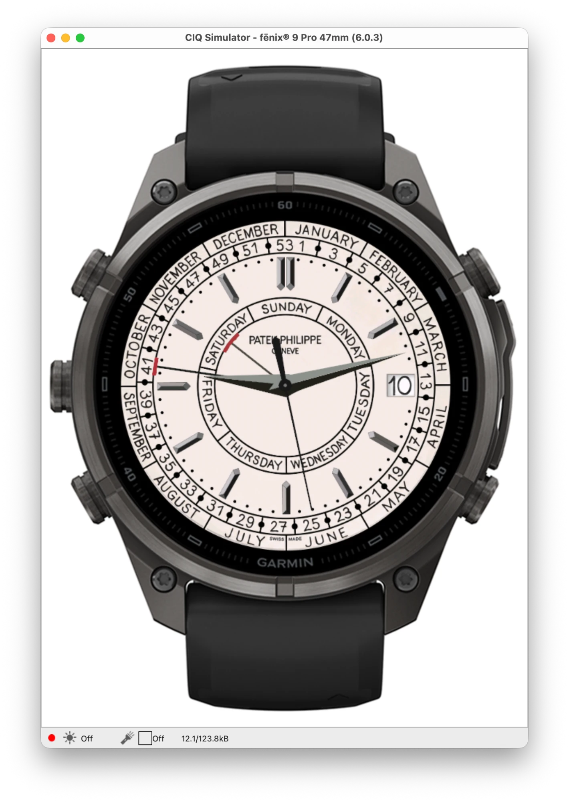

# Garmin watch face

Connect IQ watch face built from the calibrated 5212 dial in this repo.

<p align="center">
  
</p>

- **Dial:** the web dial without hands, rendered by `tools/export-assets.mjs` into one bitmap per screen size (`resources-round-<W>x<H>/`), plus one date-window bitmap per day (1–31).
- **Hands:** the five hands come from the measured shapes in `src/components/WeeklyCalendarWatch.tsx`, scaled to the screen, and are drawn as polygons. On the fēnix 9 Pro (43, 47 and 51 mm) the hour, minute and seconds hands are instead small bitmaps that `tools/export-assets.mjs` renders once at twice the screen scale (`resources-hands-<size>/hand-*.png`) and the watch shrinks and rotates about the pin with bilinear filtering (`drawBitmap2`): the watch's polygon fill rounds every corner to a whole pixel, so polygon hands move in one-pixel jumps and a thin blade changes thickness as it turns, while the filtered bitmap keeps fractional positions and a constant width. The other watches, AMOLED included, keep polygon hands until the bitmaps have been tried on them.
- **Calendar:** ISO week, weekday, and date follow the same formulas as the web dial (`source/Calendar.mc`).
- **Colours:** MIP screens (64 colours) get the dial reduced to the palette's four greys, so the cream becomes white and blended edges stay grey instead of picking up tints; AMOLED screens get the web dial's colours and a hands-only always-on view.

Behaviour that differs from the web dial, and between watches:

- The seconds hand shows only while the watch is awake. In low-power mode the watch redraws once a minute, so the seconds hand is hidden.
- On modern AMOLED watches (fēnix 8/9, epix, Venu, vívoactive, Forerunner AMOLED) the seconds hand beats eight times a second like the real calibre, and the hour and minute hands creep forward with every beat like geared hands, driven by a timer that runs only while the watch is awake. Older and MIP watches keep a plain once-a-second hand; the timer is never started there.
- On the fēnix 9 Pro the day and week pointers glide to a new position over 400 ms with the web dial's ease-out curve when the change happens while the watch is awake (`source/Glide.mc`). Asleep, in the always-on view, they jump: that view redraws once a minute and cannot animate. After waking they are drawn where they belong, without a catch-up sweep.
- On screens with burn-in protection (AMOLED), the always-on view is the dial inverted: black background, print and markers in grey at 55% white, dim pointers with muted red heads, brighter hour and minute hands, no seconds. Garmin blanks an always-on face above 10% of the screen's luminance; this view measures about 9% in the simulator's burn-in test.

## Supported watches

Only the fēnix 6 Pro build has been tried on a real watch (a fēnix 6 Pro Solar). Every other model has run in Garmin's simulator only.

<!-- devices:start -->

66 watches on 7 screen sizes. The release zip `5212-Weekly-Calendar-<version>-garmin.zip` holds one file per watch,
named `5212-Weekly-Calendar-<version>-garmin-<device id>.prg`.

| Device id             | Watch                                                                                                                                                     | Screen           |
| --------------------- | --------------------------------------------------------------------------------------------------------------------------------------------------------- | ---------------- |
| `fenix5plus`          | fēnix 5 Plus                                                                                                                                              | 240 × 240 MIP    |
| `fenix5splus`         | fēnix 5S Plus                                                                                                                                             | 240 × 240 MIP    |
| `fenix5xplus`         | fēnix 5X Plus                                                                                                                                             | 240 × 240 MIP    |
| `fenix6s`             | fēnix 6S / 6S Solar / 6S Dual Power                                                                                                                       | 240 × 240 MIP    |
| `fenix6spro`          | fēnix 6S Pro / 6S Sapphire / 6S Pro Solar / 6S Pro Dual Power                                                                                             | 240 × 240 MIP    |
| `fenix7s`             | fēnix 7S                                                                                                                                                  | 240 × 240 MIP    |
| `fenix7spro`          | fēnix 7S Pro                                                                                                                                              | 240 × 240 MIP    |
| `marqadventurer`      | MARQ Adventurer                                                                                                                                           | 240 × 240 MIP    |
| `marqathlete`         | MARQ Athlete                                                                                                                                              | 240 × 240 MIP    |
| `marqaviator`         | MARQ Aviator                                                                                                                                              | 240 × 240 MIP    |
| `marqcaptain`         | MARQ Captain / MARQ Captain: American Magic Edition                                                                                                       | 240 × 240 MIP    |
| `marqcommander`       | MARQ Commander                                                                                                                                            | 240 × 240 MIP    |
| `marqdriver`          | MARQ Driver                                                                                                                                               | 240 × 240 MIP    |
| `marqexpedition`      | MARQ Expedition                                                                                                                                           | 240 × 240 MIP    |
| `marqgolfer`          | MARQ Golfer                                                                                                                                               | 240 × 240 MIP    |
| `fenix6`              | fēnix 6 / 6 Solar / 6 Dual Power                                                                                                                          | 260 × 260 MIP    |
| `fenix6pro`           | fēnix 6 Pro / 6 Sapphire / 6 Pro Solar / 6 Pro Dual Power / quatix 6                                                                                      | 260 × 260 MIP    |
| `fenix7`              | fēnix 7 / quatix 7                                                                                                                                        | 260 × 260 MIP    |
| `fenix7pro`           | fēnix 7 Pro                                                                                                                                               | 260 × 260 MIP    |
| `fenix7pronowifi`     | fēnix 7 Pro - Solar Edition (no Wi-Fi)                                                                                                                    | 260 × 260 MIP    |
| `fenix8solar47mm`     | fēnix 8 Solar 47mm                                                                                                                                        | 260 × 260 MIP    |
| `fenix9prosolar47mm`  | fēnix 9 Pro Solar 47mm                                                                                                                                    | 260 × 260 MIP    |
| `enduro`              | Enduro                                                                                                                                                    | 280 × 280 MIP    |
| `enduro3`             | Enduro 3                                                                                                                                                  | 280 × 280 MIP    |
| `enduro4`             | Enduro 4                                                                                                                                                  | 280 × 280 MIP    |
| `fenix6xpro`          | fēnix 6X Pro / 6X Sapphire / 6X Pro Solar / tactix Delta Sapphire / Delta Solar / Delta Solar - Ballistics Edition / quatix 6X / 6X Solar / 6X Dual Power | 280 × 280 MIP    |
| `fenix7x`             | fēnix 7X / tactix 7 / quatix 7X Solar / Enduro 2                                                                                                          | 280 × 280 MIP    |
| `fenix7xpro`          | fēnix 7X Pro                                                                                                                                              | 280 × 280 MIP    |
| `fenix7xpronowifi`    | fēnix 7X Pro - Solar Edition (no Wi-Fi)                                                                                                                   | 280 × 280 MIP    |
| `fenix8solar51mm`     | fēnix 8 Solar 51mm / tactix 8 Solar 51mm                                                                                                                  | 280 × 280 MIP    |
| `fenix9prosolar51mm`  | fēnix 9 Pro Solar 51mm                                                                                                                                    | 280 × 280 MIP    |
| `epix2pro42mm`        | epix Pro (Gen 2) 42mm                                                                                                                                     | 390 × 390 AMOLED |
| `fr165`               | Forerunner 165                                                                                                                                            | 390 × 390 AMOLED |
| `fr165m`              | Forerunner 165 Music                                                                                                                                      | 390 × 390 AMOLED |
| `fr170`               | Forerunner 170                                                                                                                                            | 390 × 390 AMOLED |
| `fr170m`              | Forerunner 170 Music                                                                                                                                      | 390 × 390 AMOLED |
| `fr57042mm`           | Forerunner 570 42mm                                                                                                                                       | 390 × 390 AMOLED |
| `fr70`                | Forerunner 70                                                                                                                                             | 390 × 390 AMOLED |
| `instinct3amoled45mm` | Instinct 3 AMOLED 45mm                                                                                                                                    | 390 × 390 AMOLED |
| `marq2`               | MARQ (Gen 2) Athlete / Adventurer / Captain / Golfer / Carbon Edition / Commander - Carbon Edition                                                        | 390 × 390 AMOLED |
| `marq2aviator`        | MARQ (Gen 2) Aviator                                                                                                                                      | 390 × 390 AMOLED |
| `venu3s`              | Venu 3S                                                                                                                                                   | 390 × 390 AMOLED |
| `venu441mm`           | Venu 4 41mm                                                                                                                                               | 390 × 390 AMOLED |
| `vivoactive5`         | vívoactive 5                                                                                                                                              | 390 × 390 AMOLED |
| `vivoactive6`         | vívoactive 6                                                                                                                                              | 390 × 390 AMOLED |
| `epix2`               | epix (Gen 2) / quatix 7 Sapphire                                                                                                                          | 416 × 416 AMOLED |
| `epix2pro47mm`        | epix Pro (Gen 2) 47mm / quatix 7 Pro                                                                                                                      | 416 × 416 AMOLED |
| `fenix843mm`          | fēnix 8 43mm                                                                                                                                              | 416 × 416 AMOLED |
| `fenix943mm`          | fēnix 9 43mm                                                                                                                                              | 416 × 416 AMOLED |
| `fenix9pro43mm`       | fēnix 9 Pro 43mm                                                                                                                                          | 416 × 416 AMOLED |
| `fenixe`              | fēnix E                                                                                                                                                   | 416 × 416 AMOLED |
| `fr265`               | Forerunner 265                                                                                                                                            | 416 × 416 AMOLED |
| `instinct3amoled50mm` | Instinct 3 AMOLED 50mm                                                                                                                                    | 416 × 416 AMOLED |
| `venu2`               | Venu 2                                                                                                                                                    | 416 × 416 AMOLED |
| `venu2plus`           | Venu 2 Plus                                                                                                                                               | 416 × 416 AMOLED |
| `epix2pro51mm`        | epix Pro (Gen 2) 51mm / D2 Mach 1 Pro / tactix 7 – AMOLED Edition                                                                                         | 454 × 454 AMOLED |
| `fenix847mm`          | fēnix 8 47mm / 51mm / tactix 8 47mm / 51mm / quatix 8 47mm / 51mm                                                                                         | 454 × 454 AMOLED |
| `fenix8pro47mm`       | fēnix 8 Pro 47mm / 51mm / MicroLED / quatix 8 Pro 47mm / 51mm                                                                                             | 454 × 454 AMOLED |
| `fenix947mm`          | fēnix 9 47mm / 51mm                                                                                                                                       | 454 × 454 AMOLED |
| `fenix9pro47mm`       | fēnix 9 Pro 47mm                                                                                                                                          | 454 × 454 AMOLED |
| `fr57047mm`           | Forerunner 570 47mm                                                                                                                                       | 454 × 454 AMOLED |
| `fr965`               | Forerunner 965                                                                                                                                            | 454 × 454 AMOLED |
| `fr970`               | Forerunner 970                                                                                                                                            | 454 × 454 AMOLED |
| `venu3`               | Venu 3                                                                                                                                                    | 454 × 454 AMOLED |
| `venu445mm`           | Venu 4 45mm / D2 Air X15                                                                                                                                  | 454 × 454 AMOLED |
| `fenix9pro51mm`       | fēnix 9 Pro 51mm                                                                                                                                          | 466 × 466 AMOLED |

<!-- devices:end -->

## How the files fit together

| Path                       | Written by  | Role                                                     |
| -------------------------- | ----------- | -------------------------------------------------------- |
| `manifest.xml`             | by hand     | App id, name, and the list of device ids                 |
| `source/*.mc`              | by hand     | The watch face (`Generated.mc` is written by the export) |
| `resources/`               | by hand     | App name and the base launcher icon                      |
| `resources-round-<W>x<H>/` | `export.sh` | Dial and date-window bitmaps for one screen size         |
| `resources-icon-<N>/`      | `export.sh` | Launcher icon at one icon size                           |
| `monkey.jungle`            | `export.sh` | Assigns each device its icon folder                      |
| `README.md` (table above)  | `export.sh` | Supported-watches table                                  |

The Connect IQ build chooses `resources-round-<W>x<H>/` for every device of that screen size on its own (the SDK's `bin/default.jungle` defines these family qualifiers). Only the launcher icon size varies between devices of one size, which is why `monkey.jungle` is generated.

## Requirements

- Connect IQ SDK 9.2.0 and the device files for every id in `manifest.xml`, installed with Garmin's SDK Manager.
- Java 21: `brew install openjdk@21` (the scripts use `/opt/homebrew/opt/openjdk@21`).
- A Connect IQ developer key, kept outside the repo. The default path is `~/garmin/keys/developer_key.der`; set `GARMIN_DEVELOPER_KEY` to use another one. To create one:

  ```bash
  openssl genrsa 4096 | openssl pkcs8 -topk8 -inform PEM -outform DER -nocrypt -out ~/garmin/keys/developer_key.der
  ```

- For re-exporting the dial: `npm ci` at the repo root and Google Chrome installed (Playwright drives it).

## Commands

```bash
./garmin/run.sh fenix9pro47mm          # build one device and load it into the Connect IQ simulator
RELEASE=1 ./garmin/build.sh fenix6pro  # release build: garmin/release/5212-fenix6pro.prg
./garmin/export.sh                     # re-render dial bitmaps, icons, monkey.jungle and the table
npm run build:release -- v1.2.0        # release files for every device (see the main README)
```

## Adding a watch

1. Install its device files with the SDK Manager.
2. Add `<iq:product id="…"/>` to `manifest.xml`. The screen must be round and show at least 64 colours; the export refuses anything else (the 8-colour Forerunner 55 class makes the dial unreadable).
3. Run `./garmin/export.sh`. New screen or icon sizes get their folders; the table above updates.
4. Build it and check it in the simulator: `./garmin/run.sh <device id>`.

## Installing on a watch

Release builds (`RELEASE=1 ./garmin/build.sh <device>`) land in `garmin/release/`. The steps to copy one onto a watch, per operating system, are in the main README under [Install → Garmin watch face](../README.md#garmin-watch-face).
